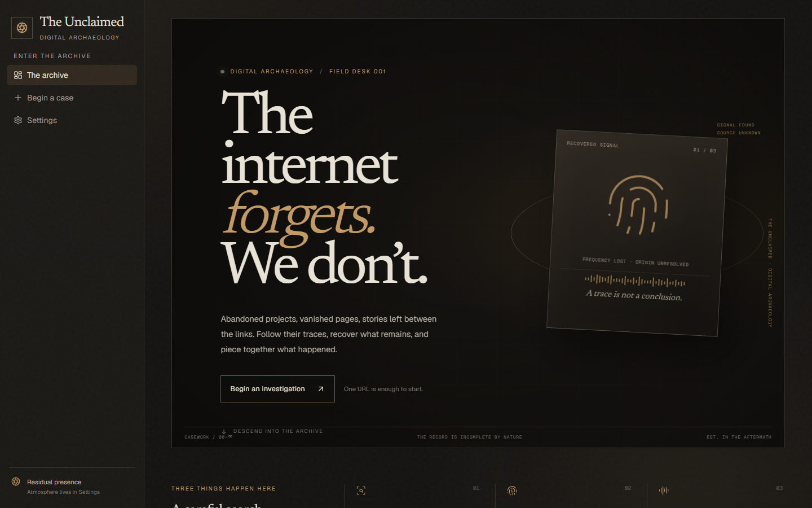
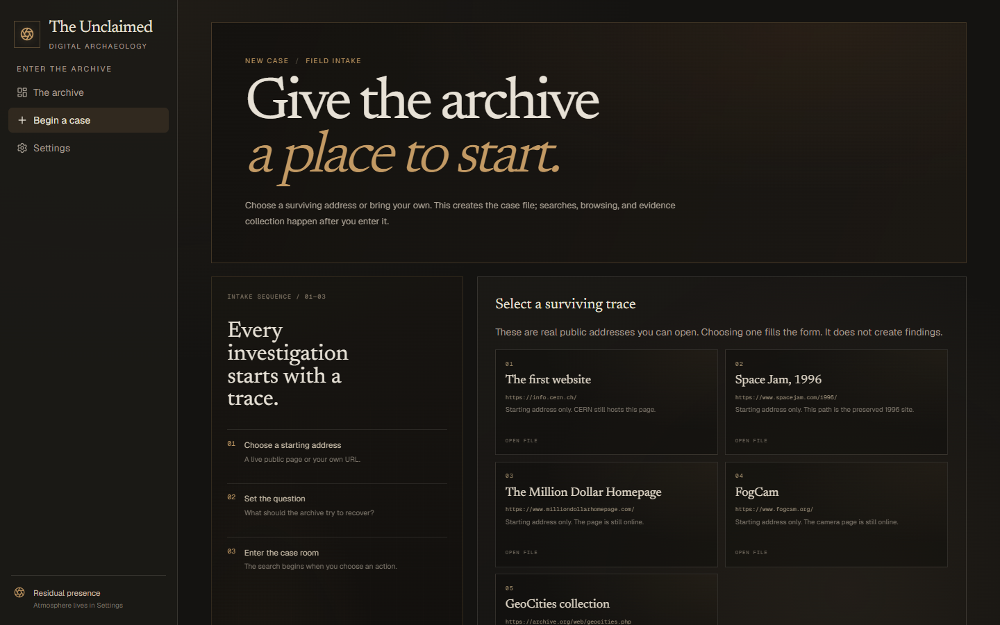

# THE UNCLAIMED

THE UNCLAIMED is a local digital-archaeology workspace. It keeps an investigation’s sources, page observations, archive captures, and model findings in PostgreSQL, then draws only those stored rows as an evidence graph and a historical timeline. A separate Residual Presence layer can play in-app visual events and local audio while an investigation is open. Search snippets and the sample layout are leads or labeled placeholders. They are not findings.

## Screenshots and demo

The short walkthrough moves from the archive landing page to the case intake screen. It uses real interface captures and does not create an investigation.


| Archive landing page | Case intake |
| --- | --- |
|  |  |

## Deployment

The Render Blueprint runs the Next.js application and a private Ollama service with Gemma 3 4B. See [DEPLOYMENT.md](DEPLOYMENT.md) for configuration, cost estimates, and the deployment checklist.

## Architecture


The diagram separates the investigator's browser, Render services, and managed providers. The Next.js server owns secret-bearing API calls and uses Drizzle to store investigations, sources, observations, and findings in Tiger Data. Findings pass Zod validation, and verified claims must quote text already stored as evidence.

Production artifacts require private DigitalOcean Spaces storage; PostgreSQL holds their metadata. The deployed app never writes user files to Render's local disk. `.data/artifacts` is a local-development fallback only. Static ambient audio is served from `public/audio`, while Residual Presence and AudioManager run in the browser without calling the search, archive, browser, or model providers.

Inference always uses Gemma 3 4B. Local development connects to loopback Ollama; Render connects to a separate private model service through a bearer-authenticated gateway. The raw Ollama port is never public. Sentry receives scrubbed errors and traces without request bodies, database URLs, or model prompts. See [DEPLOYMENT.md](DEPLOYMENT.md) for the service configuration and [the architecture notes](docs/architecture.md) for data-flow and trust-boundary details.

## Technology stack

- Next.js 16 App Router, React 19, TypeScript, Tailwind CSS
- Drizzle ORM and Tiger Data (TimescaleDB / PostgreSQL)
- SerpApi, Browserbase, Playwright
- Internet Archive Wayback
- Ollama with `gemma3:4b`
- `@xyflow/react` for the evidence graph
- ElevenLabs, used only by the audio generation script
- Sentry for Next.js
- `@aws-sdk/client-s3` for optional DigitalOcean Spaces

## Installation

```bash
cd the-unclaimed
npm install
```

Ollama needs to be running on this machine with `gemma3:4b` pulled (`ollama pull gemma3:4b`). The app refuses any Ollama base URL that is not loopback.

## Environment configuration

Copy `.env.example` to `.env.local`. Leave unused values empty. `.env.local` is gitignored.

| Variable | Role |
| --- | --- |
| `DATABASE_URL` | Tiger Data / PostgreSQL URL. A remote host must include a password or the app refuses to connect. |
| `SERPAPI_API_KEY` | Google results through SerpApi. |
| `BROWSERBASE_API_KEY`, `BROWSERBASE_PROJECT_ID`, `BROWSERBASE_REGION` | Cloud browser. Region is optional. |
| `OLLAMA_BASE_URL`, `OLLAMA_MODEL` | Defaults to `http://127.0.0.1:11434` and `gemma3:4b`. |
| `ELEVENLABS_API_KEY`, `ELEVENLABS_VOICE_ID` | Audio script only. The voice id is required for the three whisper files. |
| `SENTRY_DSN`, `NEXT_PUBLIC_SENTRY_DSN`, `SENTRY_ORG`, `SENTRY_PROJECT` | Error and trace reporting. |
| `SENTRY_AUTH_TOKEN` | Source-map upload during a build. The running app does not need it. |
| `SPACES_ENDPOINT`, `SPACES_BUCKET`, `SPACES_REGION`, `SPACES_ACCESS_KEY`, `SPACES_SECRET_KEY` | Optional for local development. Required in production when uploading or opening user artifacts; production never falls back to `.data/artifacts`. |
| `SEARCH_*`, `CRAWL_*`, `ARCHIVE_*`, `OLLAMA_TIMEOUT_MS`, `PRESENCE_*`, `SPACES_URL_TTL_SECONDS` | Optional limits. Empty values use the defaults noted in `.env.example`. |

Do not commit `.env.local`. The client bundle is not given the database URL, SerpApi key, Browserbase key, ElevenLabs key, Spaces keys, or Ollama settings.

## Database migration commands

Generated SQL is in `drizzle/0000_cultured_hellion.sql` and `drizzle/0001_graceful_fallen_one.sql`.

```bash
npm run db:generate
npm run db:migrate
npm run db:studio
```

`db:migrate` applies the SQL in `drizzle/` to the database in `DATABASE_URL`. Both files have been applied to the `the-unclaimed-db` service.

## Local development

```bash
npm run dev
```

Open `http://localhost:3000`. Create an investigation from `/investigations/new`. The sample investigation at `/investigations/sample` is a labeled empty layout. It does not read or write the database.

`/settings` holds Residual Presence mode, audio mute and volumes, and the list of generated audio files. Presence defaults to disabled. Audio starts only after **Begin Investigation** is clicked, and it stops when that investigation is completed or you leave its pages.

## Audio generation

The app never calls ElevenLabs. Generate files yourself, from `the-unclaimed`:

```bash
npm run audio:list
npm run audio:generate -- --id archive_ambience
npm run audio:generate -- --all
```

`--id` accepts `archive_ambience`, `server_hum`, `radio_static`, `metal_knock`, `keyboard_click`, `glitch_sound`, `whisper_01`, `whisper_02`, or `whisper_03`. Existing files are skipped unless you pass `--force`. `--duration`, `--model`, `--prompt`, `--output`, and `--voice` apply only together with `--id`. Whispers need `ELEVENLABS_VOICE_ID`. Each command spends credits. Do not run them unless you intend to.

## Testing

```bash
npm run typecheck
npm run lint
npm test
npm run build
```

`npm test` includes unit tests and one database integration test. The integration test runs only when `DATABASE_URL` is set. It does not invent a database. A production build does not deploy the app.

In development, `GET /api/monitoring/verify` throws one controlled error so Sentry can be checked. The production build does not expose that failure as a public action to repeat.

## Known limitations

- Opening the starter investigation stores one real reading of https://info.cern.ch/. It does not add a finding.
- Internet Archive can return HTTP 429. The app surfaces that as a stopped archive lookup. It does not invent captures.
- The nine mp3 files are in `public/audio`. Playback still starts only after Begin Investigation, and only if audio is enabled in Settings.
- Spaces credentials are empty. The local file driver is what the storage test exercises.
- Sentry has been checked from the local development server. Source maps are not uploaded, and the app is not deployed.
- The archive report is an HTML page of stored rows. It is not a separate PDF download.
- Residual Presence waits 90–180 seconds for a first event and does nothing while its mode is disabled.
- Cache Components and partial prefetching are off. With them on, a dev-server refresh aborted the streamed page and the browser reloaded continuously.
