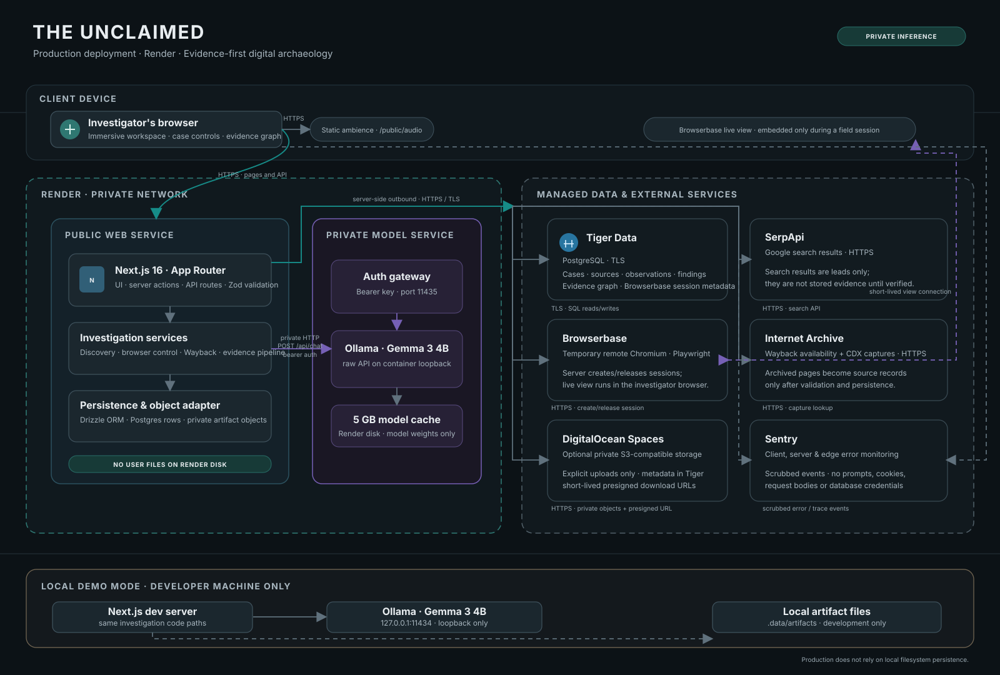

# Architecture and data flow

## Production request path

1. The investigator's browser loads the Next.js interface and static ambience over HTTPS.
2. Next.js server actions and API routes validate user input, call provider APIs, and persist validated investigation data. Provider secrets stay on the server.
3. Drizzle sends PostgreSQL reads and writes to Tiger Data over TLS. Cases, source records, observations, findings, graph rows, and temporary Browserbase session metadata live there.
4. Search discovery calls SerpApi. Archive lookups call Internet Archive Wayback. These services return candidate sources; candidate results become evidence only after the app stores and validates them.
5. Browser actions go through Next.js to create, control, and release a temporary Browserbase session. The app returns a short-lived live-view URL for the investigator's browser iframe. A live page view is not itself evidence.
6. Structured analysis calls Gemma 3 4B through the private Render model service. The app reaches an authenticated gateway on Render's private network; Ollama's raw API listens only on the model container's loopback interface.
7. If artifact upload is enabled, the app stores object bytes in a private DigitalOcean Spaces bucket and stores metadata in Tiger Data. Downloads use short-lived presigned URLs. Production artifact upload/open fails clearly if Spaces is not configured; it never writes a user file to Render's ephemeral disk.
8. Sentry receives scrubbed client, server, and edge errors/traces. Request bodies, cookies, database query data, prompts, and generation outputs are disabled.

## Local demo path

Local development keeps the same application services and Gemma model but connects to Ollama at `127.0.0.1:11434`. This loopback-only endpoint is available to the local app and is never made public. Local artifact files may live under `.data/artifacts`; this behavior is development-only. The Render model service's mounted disk stores model weights/cache only, not app records or uploaded files.

## Trust boundaries

| Boundary | Components | Protected path |
| --- | --- | --- |
| User device | Browser UI, evidence graph, timeline, Residual Presence, audio | HTTPS to the app; short-lived Browserbase live view may be embedded directly |
| Render public web service | Next.js UI, server actions, API routes, Drizzle client | Private environment variables; outbound TLS to managed APIs and database |
| Render private model service | Bearer-auth gateway and Ollama/Gemma 3 4B | Private network plus generated bearer key; no public service URL |
| Managed persistence | Tiger Data and optional DigitalOcean Spaces | TLS PostgreSQL; private objects with short-lived signed downloads |
| External providers | SerpApi, Browserbase, Internet Archive, Sentry | HTTPS; API credentials stay server-side (Sentry DSN is an ingestion identifier) |

## Main records

- Investigation, source, observation, finding, relationship/graph, artifact metadata, and browser session state: Tiger Data PostgreSQL.
- Artifact bytes: private DigitalOcean Spaces in production when enabled; local `.data/artifacts` only during development.
- Model weights: the model service's Render disk cache.
- Ambient audio: versioned static files in `public/audio`, delivered with the web app.
- User audio preferences: browser local storage; they are not application records.
